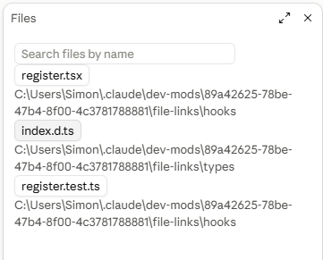

<div align="center">

<a href="https://triple-digit.com"></a>

# 📁 File Links

**Every file Claude makes, one click from File Explorer.**

A free Claude Code mod by **[Triple Digit](https://triple-digit.com)**, the AI agency that builds tailored AI solutions for each company.

[**Work with Triple Digit →**](https://triple-digit.com) &nbsp;·&nbsp; [Custom panels](#a-panel-built-for-your-team) &nbsp;·&nbsp; [Install](#install) &nbsp;·&nbsp; [How it works](#how-it-works)

</div>

<div align="center">



<sub>The Files pane. Each file is a button that opens File Explorer with that file selected.</sub>

</div>

---

## Built by Triple Digit

We build AI systems for clients all day, and every session leaves files behind: documents, scripts, exports, FFmpeg renders, downloads. Hunting for them in folders wastes time. File Links lists them in one place beside the chat, so we made it and are sharing it.

**Triple Digit is an AI agency.** We don't sell one product to everyone. We look at how *your* company actually works, then design and build the AI that fits it:

- 🤖 **Custom AI agents** that handle real work in your business: support, research, operations, reporting.
- ⚙️ **Workflow automation** across the tools your team already uses: email, CRM, docs, spreadsheets, internal systems.
- 🧠 **Agentic coding setups** like this one: Claude Code, MCP servers, mods and skills tuned to your codebase and team.
- 🌐 **AI-powered websites and internal tools**, designed, built, shipped and maintained.

If your team is wondering where AI could save hours every week, that is the conversation we like to have.

## A panel built for your team

File Links is one example of what a **custom Claude Desktop panel** can do. Claude Desktop lets a mod draw its own live panel beside your conversation, so the information your team needs is always one glance away, inside the tool they already work in.

**Triple Digit builds custom panels and mods for your company.** Each one is designed around your own workflow and data, for example:

- 📊 **Live business dashboards** next to the chat: sales, orders, support queue, campaign results.
- ✅ **Approval queues**: drafts, refunds or purchases that an AI agent has prepared and that wait for one click from you.
- 🤖 **Agent control rooms**: which automations are running, which failed and which need a human.
- 🔌 **Panels wired to your systems**: CRM, inbox, spreadsheets, internal tools, through MCP connectors we set up and secure.
- 🎨 **Your brand, your rules**: your colours, your wording, your team's permissions.

The panel stays on your machine and reads only what you connect to it. We build it, test it, hand it over and keep it working as your tools change.

👉 **[Tell us what your team looks at all day at triple-digit.com](https://triple-digit.com)**

👉 **[Book a call at triple-digit.com](https://triple-digit.com)**

---

## What it shows

File Links adds a **Files** pane beside the chat. Every file the session creates or changes is listed, newest first, with its folder underneath. **Click a file and Windows File Explorer opens with that file selected.**

When the list gets long, type in the **search field** at the top of the pane. It filters as you type, ignores upper and lower case, and matches the file name or its folder path. Clear the field to see everything again.

It picks files up from:

- **Write, Edit and NotebookEdit** tool calls.
- **Bash commands**, such as FFmpeg renders and yt-dlp downloads. After each command it adds files that changed while the command ran, found in the files and folders the command names, in the current folder, and one level of subfolders under each.

Limits: up to 30 files per Bash command, up to 200 in the list, and no more than one subfolder level. The list lives in memory, so it starts empty in each new session. Unrelated files changed in a scanned folder while a command runs can also appear. Type `/file-links` to reopen the pane.

**Windows only for now:** the click uses `explorer.exe`.

## Install

You need Claude Code **2.1.295 or newer**.

**Option A: install it as a plugin.** In a Claude Code session:

```
/plugin install file-links --marketplace ecombuilder-web/TripleDigit-file-links
```

Choose the **user** scope so it loads in every new session, desktop app sessions included.

**Option B: run it from a clone.**

```bash
git clone https://github.com/ecombuilder-web/TripleDigit-file-links.git ~/.claude/mods/file-links
```

Then add the folder to the `env` block of `~/.claude/settings.json`. Separate folders with `;` on Windows:

```json
"env": { "CLAUDE_CODE_PLUGIN_DIRS": "C:\\Users\\<you>\\.claude\\mods\\file-links" }
```

The pane opens by itself in every **new** session. A session started before the install needs a restart.

## How it works

| Piece | Role |
| --- | --- |
| `hooks/register.tsx` | The hooks module: opens the pane, records files from tool calls, scans after Bash commands, draws the search field and the list, and opens Explorer on click |
| `hooks/register.test.ts` | Tests for the pane: a written file is listed, an empty pane says so, a denied write is not listed, the search field filters the list |
| `types/index.d.ts` | State contract |

### Privacy and safety

- **Everything stays on your machine.** The mod reads file names and modified times in local folders. It makes no network requests and sends nothing anywhere.
- It never reads file contents and never changes or deletes files.
- The only thing it launches is `explorer.exe /select,<path>` for a file you click.

## Develop

Run both from the folder that holds the clone (here `~/.claude/mods/file-links`):

```bash
claude plugin validate ~/.claude/mods/file-links
claude plugin test ~/.claude/mods/file-links
```

`validate` checks the manifest, the hooks module and the state contract. `test` runs `hooks/register.test.ts` against the engine and covers the pane and its search field, not the Bash scan or the Explorer click.

## License

[MIT](LICENSE), © 2026 Triple Digit. Free to use, change and share.

---

<div align="center">

### Want AI built around how your company works?

**[Triple Digit](https://triple-digit.com)** designs and builds tailored AI agents, automations and tools for each client.

[**triple-digit.com →**](https://triple-digit.com)

<sub>File Links is an independent community mod. It is not made or endorsed by Anthropic. Claude and Claude Code are trademarks of Anthropic.</sub>

</div>
